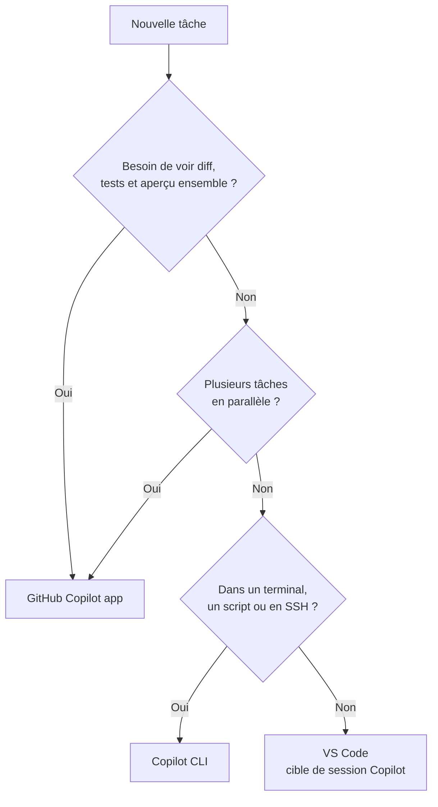

# 420 — Choisir sa surface Copilot : IDE, CLI, app, cloud agent

**Durée** : ~20 min · **Complexité** : ⭐ · **Pré-requis** : un compte GitHub avec un accès Copilot ; [.NET 10 SDK](https://dotnet.microsoft.com/download) installé

> *Copilot ne vit plus seulement dans ton éditeur. Le même agent peut travailler dans ton terminal, dans une application de bureau ou sur GitHub. La vraie question n'est plus « est-ce que Copilot sait faire ça ? » mais « où est-ce que je veux le piloter et le contrôler ? ».*

## Objectif

À la fin de ce module, tu sais :

- citer les quatre surfaces Copilot et ce que chacune fait le mieux ;
- choisir la bonne **cible de session** dans VS Code, et savoir pourquoi **Copilot** est à privilégier par rapport à **Local** ;
- choisir entre Copilot CLI et la GitHub Copilot app pour une tâche donnée ;
- lancer le projet d'exemple **Mon Sinistre** et vérifier qu'il compile avec `verify.sh`.

## Ce que tu vas apprendre

1. La famille Copilot : quatre surfaces, un même agent
2. Dans VS Code : la cible de session Copilot (SDK) plutôt que Local
3. Quand préférer le CLI, quand préférer l'app
4. Le projet fil rouge : Mon Sinistre
5. Le critère de réussite commun : `verify.sh` est vert

## Contenu pédagogique

### La famille Copilot : quatre surfaces

| Surface | Où elle tourne | Idéale pour |
|---|---|---|
| **Copilot dans l'IDE** | VS Code, Visual Studio, JetBrains… | Chat, agent et suggestions au plus près du code ouvert. Dans VS Code, la cible de session **Copilot** exécute le même moteur que le CLI et l'app (voir ci-dessous) |
| **Copilot CLI** | Ton terminal | Travail agentique au clavier, scripts, serveurs distants, mode non interactif. Peut être désactivé par ton organisation (voir encadré) |
| **GitHub Copilot app** | Application de bureau | Superviser plusieurs sessions d'agents : plans, diffs, aperçu navigateur, issues, PR, canvases, automations |
| **Copilot cloud agent** | Environnement hébergé par GitHub | Travail en arrière-plan sur une issue, qui revient sous forme de PR |

:::caution Une surface peut être bloquée par ton organisation
Avec une licence Copilot d'organisation ou d'entreprise, les admins choisissent les surfaces autorisées. En particulier, **Copilot CLI peut être désactivé** par une policy. Dans ce cas, `copilot` ne fonctionne pas, même s'il est installé. Vérifie ce qui est ouvert chez toi avant de choisir ta série : si le CLI est bloqué, passe directement à la série app ou à VS Code.
:::

Les Blocs 01 à 03 t'ont appris les **primitives** (instructions, prompts, skills, agents, MCP) et l'**ingénierie de contexte**. Ces primitives fonctionnent sur toutes les surfaces : ce bloc te montre **comment les utiliser concrètement** dans le CLI et dans l'app.

### Dans VS Code : la cible de session Copilot plutôt que Local

Dans VS Code, le chat ne lance plus un seul type d'agent. Le contrôle **Session Target** choisit le **harness**, c'est-à-dire la couche logicielle qui fait tourner l'agent : elle prépare le contexte, coordonne les appels d'outils et les approbations, et garde l'état de la session. Le modèle de langage, lui, se choisit à part.

| Cible de session | Harness | Où tournent les outils |
|---|---|---|
| **Copilot** | Harness Copilot, construit sur le [Copilot SDK](https://github.com/github/copilot-sdk) | Dans l'**Agent Host**, un processus dédié : sur ta machine, sur un hôte distant (SSH, Tunnel, WSL) ou dans un Dev Container |
| **Local** | Harness intégré de VS Code | Dans l'*extension host* du workspace courant |
| **Claude** / **Codex** | Harness du fournisseur | Sur ta machine |
| **Cloud** | Cloud agent choisi (Copilot, Claude, Codex) | Infrastructure du fournisseur, résultat rendu sous forme de PR |

Attention au vocabulaire : **Local** est le *nom d'un harness*, pas « l'agent qui tourne sur ta machine ». Copilot, Claude et Codex tournent eux aussi en local.

**Pourquoi privilégier Copilot.** La documentation VS Code recommande la cible **Copilot** pour le travail quotidien. Son harness repose sur le même Copilot SDK que **Copilot CLI** et la **GitHub Copilot app**. Tu retrouves donc dans VS Code l'essentiel de ce que la série CLI de ce bloc t'apprend :

- **même socle d'agent** : skills et instructions du dépôt réutilisables à l'identique entre VS Code et le CLI, hooks au format SDK du CLI (en Preview) ;
- **commandes du CLI** dans le chat : `/compact`, `/yolo` et `/autoApprove`, `/plugin`, ainsi que `/rubber-duck` pour un second avis en lecture seule ;
- **Autopilot** est un mode d'agent, comme dans le CLI ;
- **continuité entre surfaces** : VS Code retrouve les sessions créées dans le CLI et dans l'app, et **Resume in Terminal** reprend une session VS Code dans le CLI. Taper `copilot` dans le terminal intégré ajoute aussi la session à la liste ;
- **robustesse** : l'Agent Host tourne hors de l'*extension host*. Une extension lente ne bloque pas l'agent, et la tâche continue même si tu fermes le dossier du projet.

**Quand garder Local.** Le harness Local garde quelques atouts. Il a accès à tous les outils intégrés de VS Code et aux outils fournis par les extensions, et il accepte les modèles « bring your own key ». C'est aussi depuis une session Local qu'on lance un *handoff* vers une autre cible. À l'inverse, une session Copilot n'a pas accès à tous les outils de VS Code et des extensions. Les outils côté client ne restent disponibles que tant que la fenêtre VS Code est connectée. Enfin, une session Local ne charge pas les *Policy Hooks* du SDK, alors qu'une session Copilot les charge.

:::note Ce qui n'est pas partagé
Le SDK commun garantit un **comportement d'agent cohérent**, pas une synchronisation complète. Les outils, les modèles, les permissions et les réglages personnels peuvent encore différer entre VS Code, le CLI et l'app. Côté entreprise, les admins peuvent imposer la cible Copilot pour les nouvelles sessions de chat dans l'éditeur, via la policy `ChatEditorPreferCopilotHarness`.
:::

### CLI ou app : comment choisir

L'app ne remplace pas ton éditeur ni ton terminal. Elle répond à un problème précis : **superviser du travail d'agent de bout en bout** sans recoller soi-même le plan, le diff, les tests, l'aperçu et la PR qui sont éparpillés dans plusieurs outils.

| Ta situation | Surface conseillée |
|---|---|
| Tu codes dans VS Code et veux le même agent que le CLI, sans quitter l'éditeur | **VS Code, cible de session Copilot** |
| Tu es déjà dans le terminal, tâche courte et ciblée | **CLI** (module 421 et suivants) |
| Serveur distant en SSH, pas d'interface graphique | **CLI** |
| Tu veux scripter Copilot (`copilot -p …`) | **CLI** (module 428) |
| Plusieurs tâches d'agent en parallèle sans qu'elles se marchent dessus | **App** (worktrees, module 432) |
| Tu veux voir le diff, les tests et l'aperçu web au même endroit | **App** (module 433) |
| Tu traites des issues, des commentaires de revue, des PR | **App** (module 434) — ou le CLI avec le serveur MCP GitHub |
| Tâche répétitive à lancer chaque matin | **App** (automations, module 438) |



Les deux séries du bloc sont **indépendantes** : tu peux suivre uniquement la série CLI (421 → 429) ou uniquement la série app (430 → 438).

### Le projet fil rouge : Mon Sinistre

Tous les exercices du bloc utilisent le même projet : [`samples/mon-sinistre`](https://github.com/AxaFrance/learning-path-copilot/tree/main/samples/mon-sinistre), une petite application **C# / .NET 10** de gestion de sinistres auto. **Toutes les données sont fictives.**

| Élément | Rôle |
|---|---|
| `src/MonSinistre.Domain` | Contrats, sinistres et règles métier (couverture, indemnisation, délai de déclaration, transitions de statut) |
| `src/MonSinistre.Cli` | Console : `list`, `show <numéro>`, `declare …` — utilisée par la série CLI |
| `src/MonSinistre.Web` | Minimal API + page HTML — utilisée pour l'aperçu navigateur de l'app |
| `tests/MonSinistre.Domain.Tests` | Tests xUnit |
| `scripts/verify.sh` / `verify.ps1` | Restore + build (`-warnaserror`) + tests |
| `scripts/seed.sh` | Issues et PR d'entraînement dans ton fork (modules 434 et 438) |

Le code contient **cinq défauts volontaires** (D1 à D5) que les tests ne détectent pas : indemnisation négative, délai compté en jours calendaires, transition de statut interdite acceptée, formatage dupliqué, absence d'instructions Copilot. Tu les découvriras au fil des modules. Le tableau complet est dans le [README du projet](https://github.com/AxaFrance/learning-path-copilot/blob/main/samples/mon-sinistre/README.md#défauts-volontaires).

:::tip Design system AXA
L'interface web utilise volontairement un CSS minimal. Une équipe peut y brancher le design system AXA grâce au plugin présenté au [module 209 — Plugins](../02-composition/209-plugins.md). Ce n'est pas nécessaire pour suivre le bloc.
:::

### Le critère de réussite commun : `verify.sh`

Le projet n'a **pas de CI** : c'est un sample. Chaque exercice se termine donc de la même façon :

```bash
cd samples/mon-sinistre
./scripts/verify.sh        # Windows : pwsh ./scripts/verify.ps1
```

```text
==> SDK .NET
10.0.xxx
==> Restauration des dépendances
==> Compilation (avertissements traités comme des erreurs)
Build succeeded.
==> Tests
Passed!  - Failed: 0, Passed: 11, ...
✅ verify.sh : build et tests OK
```

Le script renvoie un code de sortie différent de 0 dès qu'une étape échoue. Copilot peut donc l'utiliser lui-même pour vérifier son travail.

## Exercice

**Énoncé** : prépare ton poste pour le bloc.

1. Fork le dépôt du handbook, puis clone ton fork.
2. Dans `samples/mon-sinistre`, lance `./scripts/verify.sh` (ou `verify.ps1`).
3. Lance `dotnet run --project src/MonSinistre.Cli -- show SIN-1004` et repère la ligne qui te paraît fausse sur le plan métier.
4. Choisis ta série (CLI, app, ou les deux) avec le tableau « CLI ou app ».

## Validation

- [ ] `verify.sh` (ou `verify.ps1`) se termine par `✅ ... build et tests OK`.
- [ ] Tu as repéré que l'indemnisation de `SIN-1004` est **négative** (défaut D1).
- [ ] Tu sais expliquer en une phrase pourquoi tu choisis le CLI ou l'app pour ta prochaine tâche.

## Pour aller plus loin

- [Module 100 — Setup & posture](../01-fondations/100-setup-posture.md) — activer Copilot sur ton compte.
- [Module 421 — Copilot CLI : installer et se connecter](./421-cli-installer-se-connecter.md) — début de la série CLI.
- [Module 430 — GitHub Copilot app : installer et faire le tour](./430-app-installer-tour.md) — début de la série app.

## Sources

- [github/copilot-cli-for-beginners](https://github.com/github/copilot-cli-for-beginners) et [github/copilot-app-for-beginners](https://github.com/github/copilot-app-for-beginners) — cours GitHub sous licence MIT, adaptés en français pour ce handbook.
- GitHub Docs — [Installing GitHub Copilot CLI](https://docs.github.com/en/copilot/how-tos/copilot-cli/set-up-copilot-cli/install-copilot-cli) · [Managing policies and features for Copilot in your organization](https://docs.github.com/en/copilot/how-tos/administer-copilot/manage-for-organization/manage-policies)
- [VS Code — Choose and use an agent harness](https://code.visualstudio.com/docs/agents/run/agent-harnesses) · [VS Code — Understand agent harnesses](https://code.visualstudio.com/docs/agents/concepts/agent-harnesses) · [github/copilot-sdk](https://github.com/github/copilot-sdk)
- [About GitHub Copilot CLI](https://docs.github.com/copilot/concepts/agents/about-copilot-cli) · [GitHub Copilot app](https://docs.github.com/copilot/concepts/agents/github-copilot-app)
- [github/copilot-cli-for-beginners — README](https://github.com/github/copilot-cli-for-beginners/blob/main/README.md)
- [github/copilot-app-for-beginners — README](https://github.com/github/copilot-app-for-beginners/blob/main/README.md)
- [copilot-app-for-beginners — Chapter 01 « Why Use the GitHub Copilot app? »](https://github.com/github/copilot-app-for-beginners/blob/main/01-tour-the-app/README.md)
