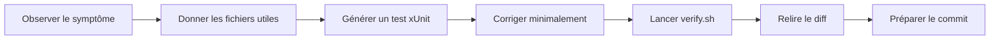

# 424 — Copilot CLI : workflows de développement

**Durée** : ~50 min · **Complexité** : ⭐⭐ · **Pré-requis** : [423 — Copilot CLI : contexte et conversations](./423-cli-contexte-conversations.md)

> *Le bon workflow n'est pas « Copilot, corrige ». C'est une boucle courte : symptôme observable, fichiers ciblés, test qui échoue, correction minimale, vérification, revue du diff.*

## Objectif

À la fin de ce module, tu sais :

- demander une revue ciblée avec Copilot CLI ;
- déboguer à partir d'un symptôme observable ;
- générer un test xUnit utile avant la correction ;
- utiliser Copilot pour relire un diff et préparer un commit ;
- corriger D1 dans Mon Sinistre, avec D2 en bonus.

## Ce que tu vas apprendre

1. Revue de code ciblée
2. Debug par symptôme
3. Génération de tests xUnit
4. Boucle correction → verify
5. Git, diff et message de commit
6. Exercice D1, bonus D2

## Contenu pédagogique

### Les cinq workflows du chapitre GitHub

Le chapitre 03 du cours Copilot CLI organise les usages de développement en cinq workflows : revue de code, refactoring, debugging, génération de tests et intégration Git.

> Source : [copilot-cli-for-beginners — 03 Development Workflows](https://github.com/github/copilot-cli-for-beginners/blob/main/03-development-workflows/README.md)

Sur Mon Sinistre, tu vas les enchaîner dans un seul fil :



Le sample Mon Sinistre demande que chaque exercice soit terminé quand le comportement est observable, que `./scripts/verify.sh` est vert, et que le diff proposé par Copilot a été relu.

> Source : [Mon Sinistre — README, Critère de réussite des exercices](https://github.com/AxaFrance/learning-path-copilot/blob/main/samples/mon-sinistre/README.md)

### Revue de code : cibler le risque

Le cours montre qu'une revue efficace nomme les catégories recherchées : validation, erreurs, cas limites, sécurité, maintenabilité. Il présente aussi `/review`, un agent spécialisé pour analyser les changements staged et unstaged.

> Source : [copilot-cli-for-beginners — 03 Development Workflows, Code Review](https://github.com/github/copilot-cli-for-beginners/blob/main/03-development-workflows/README.md)

Avant de corriger D1, demande une revue focalisée :

```text
@src/MonSinistre.Domain/CalculIndemnisation.cs
@tests/MonSinistre.Domain.Tests/CalculIndemnisationTests.cs

Review ciblée :
- cas limites de franchise ;
- sinistre non couvert ;
- montants en centimes ;
- tests manquants.
Réponds avec une checklist priorisée.
```

Le domaine stocke les montants en centimes (`long`) pour éviter les erreurs d'arrondi.

> Source : [Mon Sinistre — README, Règles métier](https://github.com/AxaFrance/learning-path-copilot/blob/main/samples/mon-sinistre/README.md)

### Debug : partir du symptôme

Le cours insiste sur le fait qu'un bon prompt de debug décrit le symptôme et l'attendu, plutôt qu'une demande vague « trouve les bugs ».

> Source : [copilot-cli-for-beginners — 03 Development Workflows, Debugging](https://github.com/github/copilot-cli-for-beginners/blob/main/03-development-workflows/README.md)

Pour D1, le symptôme est observable :

```bash
dotnet run --project src/MonSinistre.Cli -- show SIN-1004
```

Le défaut D1 indique que `show SIN-1004` affiche une indemnisation de **-80,00 €** parce que la franchise est appliquée sans plancher.

> Source : [Mon Sinistre — README, Défauts volontaires](https://github.com/AxaFrance/learning-path-copilot/blob/main/samples/mon-sinistre/README.md)

Le fichier `CalculIndemnisation.Calculer` retourne aujourd'hui `sinistre.MontantEstimeCentimes - contrat.FranchiseCentimes` quand le sinistre est couvert.

> Source : [`CalculIndemnisation.cs`](https://github.com/AxaFrance/learning-path-copilot/blob/main/samples/mon-sinistre/src/MonSinistre.Domain/CalculIndemnisation.cs)

Prompt utile :

```text
@src/MonSinistre.Domain/CalculIndemnisation.cs
@tests/MonSinistre.Domain.Tests/CalculIndemnisationTests.cs

Symptôme : show SIN-1004 affiche une indemnisation négative.
Attendu métier : montant estimé - franchise, jamais négatif.
Explique la cause probable et propose d'abord le test xUnit minimal.
```

### Générer un test xUnit avant la correction

Le cours recommande de préciser le framework quand tu demandes des tests, sinon l'outil peut générer une syntaxe qui ne correspond pas au projet.

> Source : [copilot-cli-for-beginners — 03 Development Workflows, Test Generation](https://github.com/github/copilot-cli-for-beginners/blob/main/03-development-workflows/README.md)

Ici, le framework est xUnit et les tests existants vivent dans `tests/MonSinistre.Domain.Tests`.

> Source : [Mon Sinistre — README, Structure](https://github.com/AxaFrance/learning-path-copilot/blob/main/samples/mon-sinistre/README.md)  
> Source : [`CalculIndemnisationTests.cs`](https://github.com/AxaFrance/learning-path-copilot/blob/main/samples/mon-sinistre/tests/MonSinistre.Domain.Tests/CalculIndemnisationTests.cs)

Demande :

```text
Ajoute un test xUnit dans CalculIndemnisationTests :
- contrat TousRisques avec franchise 30000 ;
- sinistre BrisDeGlace estimé à 22000 ;
- l'indemnisation attendue est 0, jamais négative.
Puis applique la correction minimale dans CalculIndemnisation.Calculer.
```

La correction métier attendue est un plancher à zéro après déduction de la franchise, tout en conservant `0` pour les sinistres non couverts.

> Source : [Mon Sinistre — README, Règles métier](https://github.com/AxaFrance/learning-path-copilot/blob/main/samples/mon-sinistre/README.md)

### D2 en bonus : délai en jours ouvrés

D2 est le défaut où `SIN-1004` est déclaré du vendredi 2026-09-18 au vendredi 2026-09-25 et devrait être dans les délais car le délai métier est de 5 jours ouvrés.

> Source : [Mon Sinistre — README, Défauts volontaires](https://github.com/AxaFrance/learning-path-copilot/blob/main/samples/mon-sinistre/README.md)

Le code actuel de `DelaiDeclaration.EstDansLesDelais` soustrait les `DayNumber`, donc compte des jours calendaires.

> Source : [`DelaiDeclaration.cs`](https://github.com/AxaFrance/learning-path-copilot/blob/main/samples/mon-sinistre/src/MonSinistre.Domain/DelaiDeclaration.cs)

Pour le bonus, garde la même boucle :

```text
@src/MonSinistre.Domain/DelaiDeclaration.cs
@tests/MonSinistre.Domain.Tests/DelaiDeclarationTests.cs

Bonus D2 : ajoute un test xUnit pour vendredi 2026-09-18 -> vendredi 2026-09-25.
Le résultat attendu est true car cela représente 5 jours ouvrés.
Propose ensuite une correction minimale qui ignore samedi et dimanche.
```

### Vérifier localement

Le sample ne fournit pas de workflow GitHub Actions ; il s'appuie sur `verify.sh` ou `verify.ps1` en local.

> Source : [Mon Sinistre — README, Pas de CI fournie](https://github.com/AxaFrance/learning-path-copilot/blob/main/samples/mon-sinistre/README.md)

```bash
./scripts/verify.sh
# Windows
pwsh ./scripts/verify.ps1
```

:::note Workflow d'équipe possible
Une équipe peut ajouter son propre workflow GitHub Actions qui lance `./samples/mon-sinistre/scripts/verify.sh` sur les PR. Ce bloc ne demande pas d'écrire ce YAML : le sample reste volontairement local.
:::

### Relire le diff et préparer Git

Le cours présente `/diff` pour visualiser les changements faits dans la session et `/review` pour analyser les changements staged ou unstaged. Il montre aussi l'usage de `git diff --staged` dans un prompt `copilot -p` pour générer un message de commit.

> Source : [copilot-cli-for-beginners — 03 Development Workflows, Git Integration](https://github.com/github/copilot-cli-for-beginners/blob/main/03-development-workflows/README.md)

Boucle recommandée :

```bash
git diff
git add src/MonSinistre.Domain/CalculIndemnisation.cs \
        tests/MonSinistre.Domain.Tests/CalculIndemnisationTests.cs
```

Puis, dans Copilot CLI :

```text
/diff
/review
```

Et pour préparer un message :

```bash
copilot -p "Génère un message de commit conventionnel en français pour ce diff staged : $(git diff --staged)"
```

Ne laisse pas Copilot remplacer ta relecture : vérifie que le test échoue bien avant correction, que la correction est minimale, et que `verify.sh` est vert après.

## Exercice

**Énoncé** : corrige D1 avec un test xUnit, puis traite D2 en bonus si tu as le temps.

1. Depuis `samples/mon-sinistre`, observe le symptôme :
   ```bash
   dotnet run --project src/MonSinistre.Cli -- show SIN-1004
   ```
2. Lance Copilot :
   ```bash
   copilot --name mon-sinistre-d1
   ```
3. Donne les fichiers et la consigne :
   ```text
   @src/MonSinistre.Domain/CalculIndemnisation.cs
   @tests/MonSinistre.Domain.Tests/CalculIndemnisationTests.cs

   Corrige D1 en TDD :
   1. ajoute un test xUnit prouvant que l'indemnisation ne devient jamais négative ;
   2. corrige CalculIndemnisation.Calculer avec un plancher à 0 ;
   3. ne modifie aucun autre fichier ;
   4. lance ./scripts/verify.sh.
   ```
4. Relis le patch proposé, puis accepte uniquement la correction minimale.
5. Lance :
   ```bash
   ./scripts/verify.sh
   ```
6. Bonus D2 :
   ```text
   @src/MonSinistre.Domain/DelaiDeclaration.cs
   @tests/MonSinistre.Domain.Tests/DelaiDeclarationTests.cs
   Corrige D2 en ajoutant d'abord un test pour 2026-09-18 -> 2026-09-25.
   ```
7. Termine par `/diff`, `/review`, puis prépare un message de commit sans forcément committer.

## Validation

- [ ] Un test xUnit couvre le cas où la franchise dépasse le montant estimé.
- [ ] `CalculIndemnisation.Calculer` ne renvoie plus de montant négatif.
- [ ] Bonus : un test couvre le délai vendredi → vendredi suivant en jours ouvrés.
- [ ] Tu as relu le diff avec `/diff` ou `git diff`.
- [ ] `./scripts/verify.sh` ou `pwsh ./scripts/verify.ps1` est vert.

## Pour aller plus loin

- [Module 317 — Orchestrer des subagents](../03-ingenierie-de-contexte/317-orchestrer-subagents.md) — comprendre quand déléguer une revue spécialisée.
- [Module 428 — Copilot CLI non interactif](./428-cli-non-interactif.md) — automatiser prudemment avec `copilot -p`.
- [Module 429 — Atelier bout en bout](./429-cli-atelier-bout-en-bout.md) — appliquer plan, code, tests et PR sur un changement plus large.

## Source

- [github/copilot-cli-for-beginners — 03 Development Workflows](https://github.com/github/copilot-cli-for-beginners/blob/main/03-development-workflows/README.md) — cours GitHub sous licence MIT, adapté en français.
- [GitHub Docs — GitHub Copilot CLI](https://docs.github.com/en/copilot/concepts/copilot-surfaces/copilot-cli)
- [GitHub Docs — Copilot CLI command reference](https://docs.github.com/en/copilot/reference/copilot-cli-reference/cli-command-reference)
- [Mon Sinistre — README](https://github.com/AxaFrance/learning-path-copilot/blob/main/samples/mon-sinistre/README.md)
