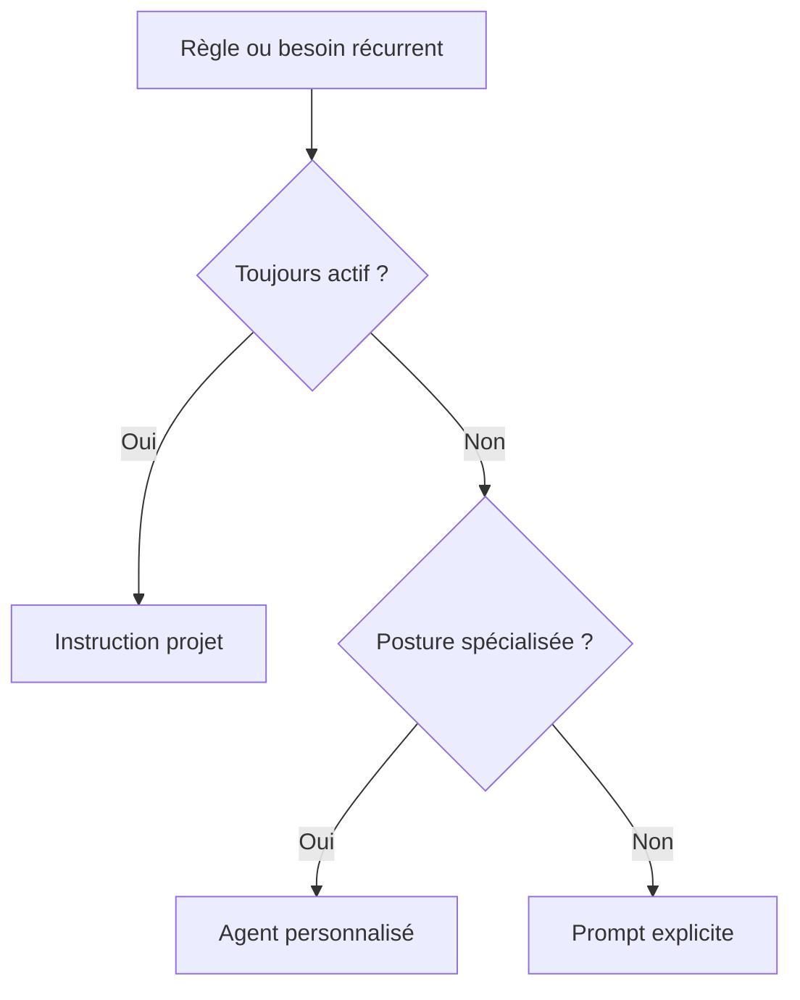

# 425 — Copilot CLI : agents et instructions projet

**Durée** : ~35 min · **Complexité** : ⭐⭐ · **Pré-requis** : [424 — Workflows de développement CLI](./424-cli-workflows-dev.md), [101 — Instructions](../01-fondations/101-instructions.md), [104 — Agents](../01-fondations/104-agents.md)

> *Un bon agent ne devine pas les règles de ton équipe : il les reçoit au bon endroit, au bon niveau de portée, puis il les réapplique sans que tu les recopies dans chaque prompt.*

## Objectif

À la fin de ce module, tu sais distinguer deux leviers complémentaires dans Copilot CLI : les **instructions projet**, chargées automatiquement à chaque session, et les **agents personnalisés**, que tu invoques quand tu veux une posture spécialisée. Tu vas concevoir les deux pour **Mon Sinistre**, mais sans les créer dans ce dépôt : l'exercice est à faire dans ton fork d'apprentissage.

> Source : [copilot-cli-for-beginners — Chapter 04: Agents and Custom Instructions](https://github.com/github/copilot-cli-for-beginners/blob/main/04-agents-custom-instructions/README.md) et [Invoking custom agents](https://docs.github.com/copilot/how-tos/copilot-cli/use-copilot-cli/invoke-custom-agents)

## Ce que tu vas apprendre

1. Où placer les instructions et les agents pour Copilot CLI
2. Quand utiliser `.github/copilot-instructions.md`, `AGENTS.md` ou un agent
3. Comment invoquer un agent avec `/agent` ou `--agent`
4. Comment cadrer un agent « relecteur-conformite » en lecture seule
5. Comment corriger le défaut D5 de Mon Sinistre par la documentation agentique

## Contenu pédagogique

### Instructions : la mémoire stable du projet

Les instructions projet servent à poser les règles qui doivent accompagner **toute** session : vocabulaire, conventions de code, validations attendues, contraintes métier et erreurs à éviter. Dans Copilot CLI, des formats de fichiers d'instructions sont chargés automatiquement, sans taper `/agent`.

> Source : [copilot-cli-for-beginners — Chapter 04, « Configuring Your Project for Copilot »](https://github.com/github/copilot-cli-for-beginners/blob/main/04-agents-custom-instructions/README.md)

Les emplacements utiles sont les suivants :

| Fichier | Portée | Usage recommandé ici |
|---|---|---|
| `AGENTS.md` | racine ou sous-dossier | standard transversal si l'équipe utilise plusieurs assistants |
| `.github/copilot-instructions.md` | dépôt | règles GitHub Copilot toujours chargées |
| `.github/instructions/*.instructions.md` | dépôt | règles spécialisées par sujet ou par glob `applyTo` |
| `~/.copilot/instructions/**/*.instructions.md` | utilisateur | préférences personnelles, non partagées |

> Source : [copilot-cli-for-beginners — Chapter 04, « Instruction File Formats »](https://github.com/github/copilot-cli-for-beginners/blob/main/04-agents-custom-instructions/README.md)

Pour Mon Sinistre, le défaut D5 est précisément l'absence de `.github/copilot-instructions.md`. Le projet sait déjà dans son README que les montants sont stockés en centimes (`long`) et que le vocabulaire métier est en français, mais Copilot ne reçoit pas encore ces règles comme contexte automatique.

> Source : [Mon Sinistre — README](../../samples/mon-sinistre/README.md)

Ce fichier doit rester court et opérationnel : il ne remplace pas le README, il extrait les règles que l'agent doit appliquer pendant qu'il lit ou modifie le code. Plus une règle est stable, plus elle mérite d'être écrite ici plutôt que répétée dans un prompt.

> Source : [copilot-cli-for-beginners — Chapter 04, « Configuring Your Project for Copilot »](https://github.com/github/copilot-cli-for-beginners/blob/main/04-agents-custom-instructions/README.md)

### Agents : des spécialistes que tu appelles

Un agent personnalisé est un profil Markdown qui décrit une expertise, des consignes et éventuellement une liste d'outils autorisés. Dans Copilot CLI, les agents de dépôt vivent sous `.github/agents/`, tandis que les agents personnels vivent sous `~/.copilot/agents/`.

> Source : [copilot-cli-for-beginners — Chapter 04, « Where to put agent files »](https://github.com/github/copilot-cli-for-beginners/blob/main/04-agents-custom-instructions/README.md) et [Invoking custom agents](https://docs.github.com/copilot/how-tos/copilot-cli/use-copilot-cli/invoke-custom-agents)

Le format courant d'un agent est un fichier `*.agent.md` avec front matter YAML :

```markdown
---
name: relecteur-conformite
description: Relit Mon Sinistre en lecture seule pour vérifier les règles métier, les tests et la conformité aux instructions projet.
tools: ["read", "search"]
---

# Relecteur conformité Mon Sinistre

Tu relis uniquement. Tu ne modifies aucun fichier.
```

> Source : [copilot-cli-for-beginners — Chapter 04, « Agent File Reference »](https://github.com/github/copilot-cli-for-beginners/blob/main/04-agents-custom-instructions/README.md)

Le champ `tools` permet de limiter les capacités. Pour un relecteur, `read` et `search` suffisent : il peut inspecter le code et les tests, mais pas éditer ni exécuter des commandes. Cette contrainte rend explicite le contrat pédagogique : l'agent produit un avis, puis toi ou l'agent par défaut décidez des changements.

> Source : [Custom agents configuration](https://docs.github.com/copilot/reference/custom-agents-configuration) et [Invoking custom agents](https://docs.github.com/copilot/how-tos/copilot-cli/use-copilot-cli/invoke-custom-agents)

### Invoquer un agent dans le CLI

En session interactive, tu peux choisir un agent avec `/agent`, puis revenir à l'agent par défaut avec la même commande. En mode programmatique, tu peux passer l'agent avec `--agent`.

> Source : [copilot-cli-for-beginners — Chapter 04, « Two ways to use custom agents »](https://github.com/github/copilot-cli-for-beginners/blob/main/04-agents-custom-instructions/README.md) et [Invoking custom agents](https://docs.github.com/copilot/how-tos/copilot-cli/use-copilot-cli/invoke-custom-agents)

```bash
copilot
> /agent
# choisir relecteur-conformite
> Relis @samples/mon-sinistre et signale uniquement les écarts aux règles métier documentées.
```

```bash
copilot --agent relecteur-conformite -p "Relis @samples/mon-sinistre/src/MonSinistre.Domain sans modifier de fichiers."
```

> Source : [Invoking custom agents](https://docs.github.com/copilot/how-tos/copilot-cli/use-copilot-cli/invoke-custom-agents)

### Instructions ou agent : choisir le bon niveau

Une règle « toujours vraie » va dans les instructions. Une posture « parfois utile » devient un agent. Sur Mon Sinistre, « les montants métier sont en centimes dans le domaine » appartient aux instructions ; « relis sans modifier et produis une liste d'écarts » appartient à l'agent relecteur.

> Source : [copilot-cli-for-beginners — Chapter 07, « Best Practices: Know the Difference »](https://github.com/github/copilot-cli-for-beginners/blob/main/07-putting-it-together/README.md)



## Exercice

**Énoncé** : dans ton fork, corrige le défaut D5 en créant les fichiers d'apprentissage suivants. Ne les crée pas dans ce dépôt handbook.

1. Depuis la racine de ton fork, ouvre Copilot CLI dans `samples/mon-sinistre`.
2. Crée `.github/copilot-instructions.md` avec ces règles minimales :
   - écrire les concepts métier en français : contrat, assuré, sinistre, formule, franchise, indemnisation ;
   - conserver les montants du domaine en centimes (`long`) ;
   - ne convertir en euros que pour l'affichage ;
   - avant de conclure, lancer `./scripts/verify.sh` ou `pwsh ./scripts/verify.ps1` ;
   - si une règle métier manque, ajouter ou adapter un test xUnit.
3. Crée `.github/agents/relecteur-conformite.agent.md` avec `tools: ["read", "search"]` et une consigne de lecture seule.
4. Lance Copilot CLI et sélectionne l'agent avec `/agent`.
5. Demande-lui de relire `@samples/mon-sinistre/src/MonSinistre.Domain` et `@samples/mon-sinistre/tests` sans modifier de fichier.
6. Reviens à l'agent par défaut, puis lance la validation :

```bash
cd samples/mon-sinistre
./scripts/verify.sh        # Windows : pwsh ./scripts/verify.ps1
```

:::caution Ne modifie pas le sample du handbook
Dans ce module, les fichiers `.github/copilot-instructions.md` et `.github/agents/relecteur-conformite.agent.md` sont des **livrables de ton fork d'exercice**. Le dépôt du handbook ne doit pas recevoir ces fichiers dans `samples/`.
:::

## Validation

- [ ] Les instructions mentionnent le vocabulaire métier français de Mon Sinistre.
- [ ] Les instructions imposent les montants en centimes dans le domaine.
- [ ] Les instructions demandent `verify.sh` ou `verify.ps1` avant conclusion.
- [ ] L'agent `relecteur-conformite` est invoquable avec `/agent`.
- [ ] L'agent n'a que des outils de lecture et recherche.
- [ ] `./scripts/verify.sh` est vert depuis `samples/mon-sinistre`.

## Pour aller plus loin

- [Module 101 — Instructions](../01-fondations/101-instructions.md) — théorie des instructions.
- [Module 104 — Agents](../01-fondations/104-agents.md) — théorie des agents.
- [Module 426 — Skills CLI](./426-cli-skills.md) — factoriser des procédures répétables.

## Source

- [github/copilot-cli-for-beginners — Chapter 04](https://github.com/github/copilot-cli-for-beginners/blob/main/04-agents-custom-instructions/README.md) — cours GitHub sous licence MIT, adapté en français.
- [github/copilot-cli-for-beginners — Chapter 07](https://github.com/github/copilot-cli-for-beginners/blob/main/07-putting-it-together/README.md) — distinction agents / skills / instructions.
- [Invoking custom agents](https://docs.github.com/copilot/how-tos/copilot-cli/use-copilot-cli/invoke-custom-agents) · [Custom agents configuration](https://docs.github.com/copilot/reference/custom-agents-configuration)
