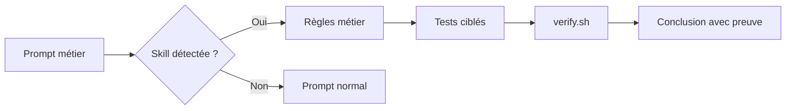

# 426 — Copilot CLI : skills réutilisables

**Durée** : ~35 min · **Complexité** : ⭐⭐ · **Pré-requis** : [425 — Agents et instructions CLI](./425-cli-agents-instructions.md), [103 — Skills](../01-fondations/103-skills.md)

> *Une instruction dit « garde cette règle en tête ». Une skill dit « quand ce type de tâche arrive, applique cette procédure complète ». C'est la différence entre un panneau dans l'atelier et un outil prêt à l'emploi.*

## Objectif

À la fin de ce module, tu sais créer une **skill** utilisable par Copilot CLI, comprendre quand elle se charge automatiquement, la gérer depuis le CLI, et l'appliquer au projet Mon Sinistre pour répéter la même checklist métier sans la recopier dans chaque prompt.

> Source : [copilot-cli-for-beginners — Chapter 05: Skills System](https://github.com/github/copilot-cli-for-beginners/blob/main/05-skills/README.md) et [About agent skills](https://docs.github.com/copilot/concepts/agents/about-agent-skills)

## Ce que tu vas apprendre

1. Ce qu'une skill ajoute par rapport aux instructions et agents
2. Où placer une skill projet ou personnelle
3. Comment Copilot CLI détecte et recharge les skills
4. Comment écrire `SKILL.md` pour Mon Sinistre
5. Comment valider que la skill mène bien à `verify.sh`

## Contenu pédagogique

### Une skill est une procédure réutilisable

Les skills sont des dossiers contenant des instructions, scripts et ressources que Copilot peut charger quand elles sont pertinentes pour la tâche. Elles servent aux travaux répétables : revue sécurité, génération de tests, préparation de PR, ou ici rappel des règles métier d'un domaine.

> Source : [About agent skills](https://docs.github.com/copilot/concepts/agents/about-agent-skills) et [copilot-cli-for-beginners — Chapter 05, « Understanding Skills »](https://github.com/github/copilot-cli-for-beginners/blob/main/05-skills/README.md)

La différence avec le module précédent est importante : `.github/copilot-instructions.md` reste toujours en contexte, tandis qu'une skill est chargée selon la description de la tâche ou invoquée directement avec une commande slash comme `/regles-gestion-sinistre`.

> Source : [Adding agent skills for GitHub Copilot CLI](https://docs.github.com/copilot/how-tos/copilot-cli/customize-copilot/add-skills)

### Emplacements et structure

Pour Copilot CLI, une skill projet peut être placée dans `.github/skills/`, et une skill personnelle dans `~/.copilot/skills/`. Les docs GitHub indiquent aussi des emplacements compatibles comme `.claude/skills`, `.agents/skills` et `~/.agents/skills` ; dans ce bloc, garde `.github/skills/` pour un partage d'équipe simple.

> Source : [Adding agent skills for GitHub Copilot CLI](https://docs.github.com/copilot/how-tos/copilot-cli/customize-copilot/add-skills) et [copilot-cli-for-beginners — Chapter 05, « Skill Locations »](https://github.com/github/copilot-cli-for-beginners/blob/main/05-skills/README.md)

Une skill minimale ressemble à ceci :

```text
.github/skills/regles-gestion-sinistre/
└── SKILL.md
```

Le fichier doit s'appeler exactement `SKILL.md`. Il contient un front matter YAML avec au minimum `name` et `description`, puis un corps Markdown qui décrit la procédure.

> Source : [Adding agent skills for GitHub Copilot CLI — Creating and adding a skill](https://docs.github.com/copilot/how-tos/copilot-cli/customize-copilot/add-skills)

### Chargement automatique et invocation directe

Copilot décide d'utiliser une skill en comparant ton prompt avec sa description. Si tu demandes « vérifie les règles de gestion d'un sinistre », une skill bien décrite peut être injectée sans que tu tapes son nom.

> Source : [copilot-cli-for-beginners — Chapter 05, « Skills are automatically triggered »](https://github.com/github/copilot-cli-for-beginners/blob/main/05-skills/README.md)

Tu peux aussi forcer l'utilisation en mentionnant la skill comme commande slash :

```bash
copilot
> /regles-gestion-sinistre Vérifie la correction du délai de déclaration dans @samples/mon-sinistre/src/MonSinistre.Domain/DelaiDeclaration.cs
```

> Source : [Adding agent skills for GitHub Copilot CLI — Using agent skills](https://docs.github.com/copilot/how-tos/copilot-cli/customize-copilot/add-skills)

Les commandes utiles côté CLI sont :

| Besoin | Commande |
|---|---|
| Lister les skills | `/skills list` |
| Recharger après création | `/skills reload` |
| Voir le détail d'une skill | `/skills info NOM` |
| Activer ou désactiver | `/skills` puis choisir l'action |

> Source : [Adding agent skills for GitHub Copilot CLI — Skills commands in the CLI](https://docs.github.com/copilot/how-tos/copilot-cli/customize-copilot/add-skills)

### Comparer instructions, agents et skills

| Primitive | Activation | Bon usage dans Mon Sinistre |
|---|---|---|
| Instruction | toujours chargée | « les montants du domaine sont en centimes » |
| Agent | sélection explicite ou suggestion | « relis en lecture seule comme relecteur conformité » |
| Skill | auto-détection ou `/nom-skill` | « applique la checklist règles métier + tests + verify » |

> Source : [copilot-cli-for-beginners — Chapter 05, « Skills vs Agents vs MCP »](https://github.com/github/copilot-cli-for-beginners/blob/main/05-skills/README.md) et [copilot-cli-for-beginners — Chapter 07, « Best Practices »](https://github.com/github/copilot-cli-for-beginners/blob/main/07-putting-it-together/README.md)

Dans Mon Sinistre, la skill `regles-gestion-sinistre` doit rappeler les règles stables : `Tiers` ne couvre pas les dommages propres, `TiersPlus` couvre bris de glace et vol, `TousRisques` couvre tout, l'indemnisation ne doit pas être négative, la déclaration se calcule en jours ouvrés, et les statuts `Indemnise` et `Refuse` sont définitifs.

> Source : [Mon Sinistre — README, « Règles métier »](../../samples/mon-sinistre/README.md)

### Garde-fous de validation

Une bonne skill ne se limite pas à lister des règles. Elle décrit aussi la preuve attendue. Pour ce bloc, la preuve est toujours locale : `./scripts/verify.sh` depuis `samples/mon-sinistre`, ou `pwsh ./scripts/verify.ps1` sous PowerShell.

> Source : [Mon Sinistre — README, « Critère de réussite des exercices »](../../samples/mon-sinistre/README.md)



## Exercice

**Énoncé** : dans ton fork, crée une skill projet `regles-gestion-sinistre`. Ne la crée pas dans ce dépôt handbook.

1. Depuis la racine de ton fork, prépare le dossier :

```bash
mkdir -p .github/skills/regles-gestion-sinistre
```

2. Crée `.github/skills/regles-gestion-sinistre/SKILL.md` avec ce contenu de départ :

```markdown
---
name: regles-gestion-sinistre
description: Applique les règles métier Mon Sinistre lors des changements sur contrats, sinistres, couverture, indemnisation, délais ou statuts. Toujours demander ou lancer verify.sh avant conclusion.
---

# Règles de gestion sinistre

Quand une tâche touche Mon Sinistre :

1. Vérifier le vocabulaire métier français : contrat, assuré, sinistre, formule, franchise, indemnisation.
2. Conserver les montants métier en centimes (`long`) dans le domaine.
3. Couverture : Tiers ne couvre pas les dommages propres ; TiersPlus couvre bris de glace et vol ; TousRisques couvre tout.
4. Indemnisation : montant estimé moins franchise, jamais négatif.
5. Délai : 5 jours ouvrés maximum après la survenance.
6. Statuts : Indemnisé et Refusé sont définitifs.
7. Si une règle change, ajouter ou adapter un test xUnit.
8. Avant de conclure, lancer depuis `samples/mon-sinistre` : `./scripts/verify.sh` ou `pwsh ./scripts/verify.ps1`.
```

3. Dans Copilot CLI, recharge et inspecte :

```text
/skills reload
/skills info regles-gestion-sinistre
```

4. Teste l'activation naturelle :

```text
Vérifie les règles de gestion sinistre pour @samples/mon-sinistre/src/MonSinistre.Domain/CalculIndemnisation.cs. Ne modifie rien ; dis quels tests devraient prouver la règle.
```

5. Teste l'invocation directe :

```text
/regles-gestion-sinistre Propose les tests manquants pour éviter une indemnisation négative sur SIN-1004.
```

6. Termine par :

```bash
cd samples/mon-sinistre
./scripts/verify.sh
```

:::tip Réutiliser sans surcharger
Si une règle doit être active dans **toutes** les conversations, elle appartient aussi aux instructions du module 425. Si elle décrit une procédure complète à appliquer quand le sujet apparaît, elle est parfaite pour une skill.
:::

## Validation

- [ ] Le dossier de skill contient un fichier nommé exactement `SKILL.md`.
- [ ] Le front matter contient `name` et `description`.
- [ ] La description mentionne les situations où la skill doit s'activer.
- [ ] La skill rappelle les règles métier clés de Mon Sinistre.
- [ ] La skill impose tests et `verify.sh` avant conclusion.
- [ ] `/skills info regles-gestion-sinistre` retrouve la skill.
- [ ] `./scripts/verify.sh` est vert depuis `samples/mon-sinistre`.

## Pour aller plus loin

- [Module 103 — Skills](../01-fondations/103-skills.md) — théorie générale.
- [Module 425 — Agents et instructions CLI](./425-cli-agents-instructions.md) — socle toujours chargé.
- [Module 427 — MCP CLI](./427-cli-mcp.md) — donner à Copilot des outils externes.

## Source

- [github/copilot-cli-for-beginners — Chapter 05](https://github.com/github/copilot-cli-for-beginners/blob/main/05-skills/README.md) — cours GitHub sous licence MIT, adapté en français.
- [github/copilot-cli-for-beginners — Chapter 07](https://github.com/github/copilot-cli-for-beginners/blob/main/07-putting-it-together/README.md) — distinction skills / agents / instructions.
- [About agent skills](https://docs.github.com/copilot/concepts/agents/about-agent-skills) · [Adding agent skills for GitHub Copilot CLI](https://docs.github.com/copilot/how-tos/copilot-cli/customize-copilot/add-skills)
