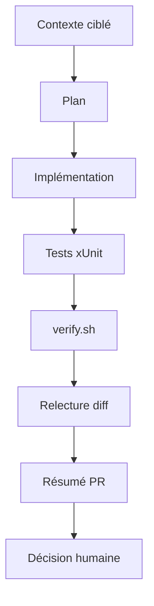

# 429 — Copilot CLI : atelier bout en bout

**Durée** : ~60 min · **Complexité** : ⭐⭐⭐ · **Pré-requis** : [421](./421-cli-installer-se-connecter.md) → [428](./428-cli-non-interactif.md)

> *La valeur du CLI n'est pas de taper moins de commandes. C'est de garder le fil complet : contexte, plan, changement, tests, validation et préparation de PR, sans perdre la responsabilité de relire.*

## Objectif

À la fin de ce module, tu sais mobiliser toute la série CLI pour livrer une petite évolution de Mon Sinistre : ajouter la formule `TousRisquesPlus`, écrire les tests associés, lancer `verify.sh`, relire le diff et préparer une PR. Le bonus te propose aussi de corriger le défaut D2 sur les jours ouvrés.

## Ce que tu vas apprendre

1. Démarrer par le contexte et le plan
2. Utiliser instructions, agent, skill et MCP sans les confondre
3. Ajouter une règle métier de bout en bout
4. Valider par tests et `verify.sh`
5. Préparer une PR sans abandonner la revue humaine

## Contenu pédagogique

### Le workflow complet

Le chapitre final du cours CLI propose une boucle complète : rassembler le contexte, planifier, implémenter, tester, relire, puis préparer une PR. Il rappelle aussi que les agents, skills et MCP ne sont pas obligatoires pour être productif, mais qu'ils deviennent utiles quand la tâche est assez structurée.

Pour Mon Sinistre, tu vas appliquer cette boucle à une évolution métier d'atelier : ajouter `TousRisquesPlus`, une nouvelle formule demandée par l'exercice. Le dépôt de départ contient déjà les formules `Tiers`, `TiersPlus` et `TousRisques`, ce qui donne le point d'insertion naturel.

La règle existante est : `Tiers` ne couvre pas les dommages propres, `TiersPlus` couvre bris de glace et vol, `TousRisques` couvre tout. L'évolution doit donc être ajoutée sans casser les tests existants.

### Réutiliser les modules 421 à 428

| Module | Ce que tu réutilises dans l'atelier |
|---|---|
| 421 | CLI installé, authentifié, lancé au bon endroit |
| 422 | modes interactif, plan, slash commands |
| 423 | contexte avec `@samples/mon-sinistre/...` |
| 424 | boucle développement : modifier, tester, relire |
| 425 | instructions et agent relecteur conformité |
| 426 | skill `regles-gestion-sinistre` |
| 427 | GitHub MCP pour lire issue ou préparer PR |
| 428 | appel non interactif éventuel pour une revue bornée |

### Plan avant code

Commence par attacher les bons fichiers, puis demande un plan. Le plan doit identifier au minimum `Formule.cs`, `RegleCouverture.cs`, `CalculIndemnisation.cs`, les tests de couverture, les tests d'indemnisation et éventuellement les données d'exemple si tu veux démontrer la nouvelle formule dans une commande CLI.

Exemple de prompt de plan :

```text
/plan @samples/mon-sinistre/src/MonSinistre.Domain @samples/mon-sinistre/tests
Ajoute une formule TousRisquesPlus.
Règle : elle couvre tous les types de sinistres ; pour BrisDeGlace, la franchise appliquée est 0 ; pour Vol et Collision, garder la franchise du contrat.
Prévois les tests xUnit et la validation ./scripts/verify.sh. Ne modifie rien avant le plan.
```

### Implémenter petit et prouvé

La modification naturelle commence par l'énumération `Formule`, puis la règle de couverture. Pour la franchise à 0 sur bris de glace, évite de dupliquer du formatage ou d'introduire des montants en euros dans le domaine : les montants restent des centimes.

Le test le plus important doit prouver que `TousRisquesPlus` couvre `BrisDeGlace`, `Vol` et `Collision`. Un autre test doit prouver que l'indemnisation d'un bris de glace avec `TousRisquesPlus` ne retire pas la franchise.

Demande ensuite l'implémentation :

```text
Implémente le plan de manière minimale. Ajoute les tests xUnit nécessaires. Ne change pas l'interface web. Garde les montants en centimes dans le domaine.
```

Après chaque changement significatif, inspecte le diff. La revue humaine reste obligatoire, même si Copilot annonce que tout est terminé.

### Validation locale

Le sample Mon Sinistre n'embarque pas de CI fournie. Le critère commun est `./scripts/verify.sh`, qui restaure, compile avec avertissements traités comme erreurs, puis lance les tests.

```bash
cd samples/mon-sinistre
./scripts/verify.sh        # Windows : pwsh ./scripts/verify.ps1
```

Si la validation échoue, ne demande pas « corrige tout » sans contexte. Colle ou attache l'erreur pertinente, rappelle la règle métier, puis demande une correction ciblée.

### Préparer la PR

Quand le diff est relu et `verify.sh` vert, demande à Copilot de préparer un résumé de PR : contexte, changements, tests lancés, risques. Si tu utilises le serveur GitHub MCP, tu peux aussi demander la création de PR dans ton fork, mais garde le contrôle sur le titre et la description avant publication.

Exemple de demande :

```text
Prépare une description de PR en français pour l'ajout de TousRisquesPlus.
Inclure : résumé, règles métier ajoutées, tests, commande verify.sh, risques et points de revue.
Ne crée pas la PR tant que je n'ai pas relu.
```

:::note Une équipe peut ajouter son propre workflow
Si ce sample devient un projet d'équipe, elle peut ajouter sa propre CI pour lancer `./samples/mon-sinistre/scripts/verify.sh` sur PR. Ce module ne fournit pas de workflow YAML complet.
:::

### Bonus D2 : jours ouvrés

Le défaut D2 indique que le délai de déclaration utilise des jours calendaires au lieu de jours ouvrés. Le symptôme donné est `SIN-1004` : du vendredi 2026-09-18 au vendredi 2026-09-25, le code affiche « Dans les délais : non » alors que cela représente 5 jours ouvrés.

Si tu fais le bonus, traite-le comme une deuxième mini-PR logique : plan séparé, tests dédiés, correction de `DelaiDeclaration`, puis `verify.sh`. N'entremêle pas ce bonus avec `TousRisquesPlus` si ton objectif est une PR facile à relire.



## Exercice

**Énoncé** : dans ton fork, ajoute `TousRisquesPlus` de bout en bout avec Copilot CLI.

1. Crée une branche dédiée :

```bash
git switch -c feature/tous-risques-plus
```

2. Lance Copilot CLI depuis la racine du fork.
3. Attache le contexte minimal : domaine, tests, README Mon Sinistre.
4. Demande le plan avec le prompt proposé plus haut.
5. Relis le plan : fichiers touchés, tests prévus, règle de franchise.
6. Demande l'implémentation minimale.
7. Lance les tests :

```bash
cd samples/mon-sinistre
./scripts/verify.sh
```

8. Reviens à la racine, inspecte :

```bash
git diff -- samples/mon-sinistre
```

9. Invoque l'agent `relecteur-conformite` du module 425 si tu l'as créé.
10. Invoque la skill `regles-gestion-sinistre` du module 426 si tu l'as créée.
11. Prépare une description de PR, relis-la, puis crée la PR dans ton fork si ton exercice le demande.

**Bonus D2** : dans une branche séparée, corrige le calcul des 5 jours ouvrés et ajoute un test couvrant vendredi → vendredi suivant.

## Validation

- [ ] `Formule` contient `TousRisquesPlus`.
- [ ] `TousRisquesPlus` couvre bris de glace, vol et collision.
- [ ] Un bris de glace `TousRisquesPlus` applique une franchise de 0.
- [ ] Les montants restent en centimes dans le domaine.
- [ ] Les tests xUnit couvrent la nouvelle formule.
- [ ] `./scripts/verify.sh` est vert depuis `samples/mon-sinistre`.
- [ ] Le diff ne contient pas de modification hors besoin.
- [ ] La description de PR mentionne changements, tests et risques.
- [ ] Bonus : le délai D2 est corrigé dans une branche ou PR séparée.

## Pour aller plus loin

- [Module 317 — Orchestrer des subagents](../03-ingenierie-de-contexte/317-orchestrer-subagents.md) — décider quand déléguer.
- [Module 428 — Mode non interactif](./428-cli-non-interactif.md) — revue scriptée locale.
- [Module 430 — Copilot app : installer et tour](./430-app-installer-tour.md) — refaire l'atelier côté app.

## Sources

- [github/copilot-cli-for-beginners — Chapter 07](https://github.com/github/copilot-cli-for-beginners/blob/main/07-putting-it-together/README.md) — cours GitHub sous licence MIT, adapté en français.
- [github/copilot-cli-for-beginners — Chapter 01](https://github.com/github/copilot-cli-for-beginners/blob/main/01-setup-and-first-steps/README.md) et [Chapter 03](https://github.com/github/copilot-cli-for-beginners/blob/main/03-development-workflows/README.md) — modes et boucle développement.
- [GitHub Copilot CLI](https://docs.github.com/copilot/concepts/agents/about-copilot-cli) · [Mon Sinistre — README](https://github.com/AxaFrance/learning-path-copilot/blob/main/samples/mon-sinistre/README.md)
- [Mon Sinistre — Formule.cs](https://github.com/AxaFrance/learning-path-copilot/blob/main/samples/mon-sinistre/src/MonSinistre.Domain/Formule.cs)
- [copilot-app-for-beginners — Troubleshooting Reference, « General rule »](https://github.com/github/copilot-app-for-beginners/blob/main/appendices/troubleshooting-reference.md)
