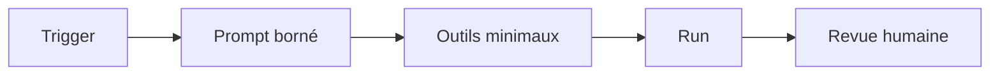

# 438 — GitHub Copilot app : automations locales et cloud

**Durée** : ~50 min · **Complexité** : ⭐⭐⭐ · **Pré-requis** : [437 — Canvases](./437-app-canvases.md), [434 — Workflows GitHub dans l'app](./434-app-workflows-github.md)

> *Si tu tapes le même rapport tous les matins, écris-le une fois. Mais commence par un bouton manuel, lis le résultat, puis seulement pense au planning.*

## Objectif

À la fin de ce module, tu sais créer une automation de préparation des PR Mon Sinistre en lecture seule, la tester en local, puis décider prudemment si elle mérite un déclencheur Daily, CRON, événementiel ou cloud.

## Ce que tu vas apprendre

1. Les quatre pièces d'une automation : trigger, prompt, outils, revue.
2. Pourquoi commencer manuel et local.
3. Comment planifier en Daily ou CRON.
4. Pourquoi les triggers événementiels et le cloud exigent le moindre privilège.

## Contenu pédagogique

### Une automation est un run enregistré

Une automation sauvegarde une tâche d'agent récurrente. Dans l'app, elle peut être lancée à la demande ou sur calendrier ; la documentation mentionne aussi des automations locales et cloud.

Le cours résume une automation en quatre questions : qu'est-ce qui la déclenche, quel prompt exécuter, quels outils sont nécessaires, et où relire le résultat.



### Manuel et local d'abord

Le cours recommande de commencer par une automation manuelle et locale. Elle ne tourne que quand tu la démarres, ce qui permet de tester le prompt, inspecter le résultat, réduire le périmètre et éviter les exécutions surprises.

Pour Mon Sinistre, l'automation de départ doit être un rapport de préparation des PR créées par `seed.sh`. Le script crée trois PR d'entraînement avec le label `mon-sinistre` : une prête à merger, une qui casse `verify.sh`, et une avec un commentaire de revue sur le formatage des montants.

La première version doit être explicitement **lecture seule**. Elle peut lister les PR, résumer les statuts, repérer commentaires et échecs, mais ne doit pas poster de commentaire, changer de label, approuver ni merger.

### Prompt de rapport PR Mon Sinistre

Voici un prompt adapté au sample :

```text
Rapport de préparation des PR Mon Sinistre.

Périmètre : ce dépôt uniquement, PR ouvertes avec le label `mon-sinistre`, notamment celles créées par `./samples/mon-sinistre/scripts/seed.sh`.

Pour chaque PR, retourne un tableau avec :
- numéro, titre et branche ;
- état des checks ou, s'il n'y a pas de CI, la validation locale attendue ;
- commentaires de revue non résolus ou à traiter ;
- type de risque : texte seul, test cassé, duplication métier, autre ;
- prochaine action humaine unique.

Contraintes : lecture seule. Ne modifie aucun fichier, ne pousse rien, ne poste aucun commentaire, ne change aucun label, n'approuve pas et ne merge pas.
Si une information manque, écris « non vérifié » au lieu d'inventer.
```

Le projet Mon Sinistre n'embarque volontairement aucun workflow GitHub Actions. Quand le rapport parle de validation, il doit donc pointer vers `./samples/mon-sinistre/scripts/verify.sh` plutôt que prétendre qu'une CI existe.

:::note Workflow d'équipe possible
Une équipe peut ajouter son propre workflow GitHub Actions pour lancer `verify.sh` sur les PR. Ce module ne fournit pas de YAML : il se limite à la pratique app et au script local du sample.
:::

### Daily, CRON et bruit

Une fois le rapport manuel utile, tu peux passer à un déclencheur Daily pour un résumé du matin, ou à CRON si tu as besoin d'une expression plus précise. L'app valide l'expression CRON locale et affiche une prévisualisation lisible.

Si le rapport devient trop long, filtre : `label:mon-sinistre`, PR ouvertes seulement, branches `entrainement/*`, ou PR avec commentaire de revue. Une automation utile réduit l'attention nécessaire ; elle ne doit pas devenir une notification de plus.

### Event triggers et injection de prompt

Les déclencheurs événementiels lancent l'automation quand un événement arrive, par exemple une issue ou une pull request. La documentation GitHub cite les triggers de planning, d'issue créée, de pull request ouverte et de pull request synchronisée pour les automations cloud.

Ces triggers lisent du texte potentiellement non fiable : titre de PR, description, commentaire, issue. C'est un contexte classique d'injection de prompt. La règle de départ est donc : lecture seule, filtre étroit, aucun outil d'écriture tant que plusieurs runs n'ont pas prouvé leur qualité.

### Cloud automations : utile, mais pas par défaut

Une automation locale tourne depuis ta machine et dépend de l'app ouverte. Une automation cloud tourne sur l'infrastructure hébergée, donc elle peut s'exécuter quand ton ordinateur est fermé.

GitHub indique que les automations cloud nécessitent notamment un dépôt privé ou interne, l'activation de Copilot cloud agent, et des autorisations d'organisation compatibles. Chaque run cloud démarre une session cloud agent qui consomme des minutes GitHub Actions et des crédits IA, facturés à la personne qui a créé l'automation.

Si tu passes ce rapport PR en cloud, sélectionne seulement les outils de lecture nécessaires : lister/rechercher/lire les PR, et éventuellement lire les checks. Ne sélectionne pas les outils de création de PR, push, labels, commentaires ou merge pour un rapport.

## Exercice

**Énoncé** : créer le « Rapport de préparation des PR Mon Sinistre » en lecture seule.

1. Depuis la racine de ton fork, prépare les données si ce n'est pas déjà fait :

```bash
./samples/mon-sinistre/scripts/seed.sh
```

2. Dans l'app, ouvre **Automations**, puis **New automation**.
3. Nom : `Rapport PR Mon Sinistre`.
4. Trigger : **Manual**.
5. Garde **Run in the cloud** désactivé pour la première version.
6. Sélectionne le projet de ton fork et le workspace courant.
7. Colle le prompt de rapport ci-dessus, puis **Create and run**.
8. Inspecte l'historique du run et vérifie qu'aucune action d'écriture n'a eu lieu.
9. Si le rapport est clair pendant plusieurs runs, teste un déclencheur **Daily** ou **CRON**.

## Validation

- [ ] Les PR créées par `seed.sh` existent avec le label `mon-sinistre`.
- [ ] L'automation est d'abord manuelle, locale et lecture seule.
- [ ] Le rapport distingue PR prête, PR qui casse `verify.sh`, et PR avec commentaire de revue.
- [ ] Le prompt interdit explicitement commentaires, labels, approbation et merge.
- [ ] Pour toute correction de code faite ensuite, `./scripts/verify.sh` est vert depuis `samples/mon-sinistre`.

## Pour aller plus loin

- [434 — Workflows GitHub dans l'app](./434-app-workflows-github.md) — manipuler issues, PR et revues à la main.
- [437 — Canvases](./437-app-canvases.md) — suivre le progrès et les preuves dans une surface visible.
- [105 — Hooks](../01-fondations/105-hooks.md) — comparer déclenchement local et automatisation.

## Sources

- [github/copilot-app-for-beginners — Chapter 07](https://github.com/github/copilot-app-for-beginners/blob/main/07-automations/README.md) — cours GitHub sous licence MIT, adapté en français.
- [Using automations in the GitHub Copilot app](https://docs.github.com/en/copilot/how-tos/github-copilot-app/using-automations)
- [About Copilot automations](https://docs.github.com/en/copilot/concepts/agents/cloud-agent/about-automations)
- [README Mon Sinistre](https://github.com/AxaFrance/learning-path-copilot/blob/main/samples/mon-sinistre/README.md)
- [`samples/mon-sinistre/scripts/seed.sh`](https://github.com/AxaFrance/learning-path-copilot/blob/main/samples/mon-sinistre/scripts/seed.sh)
